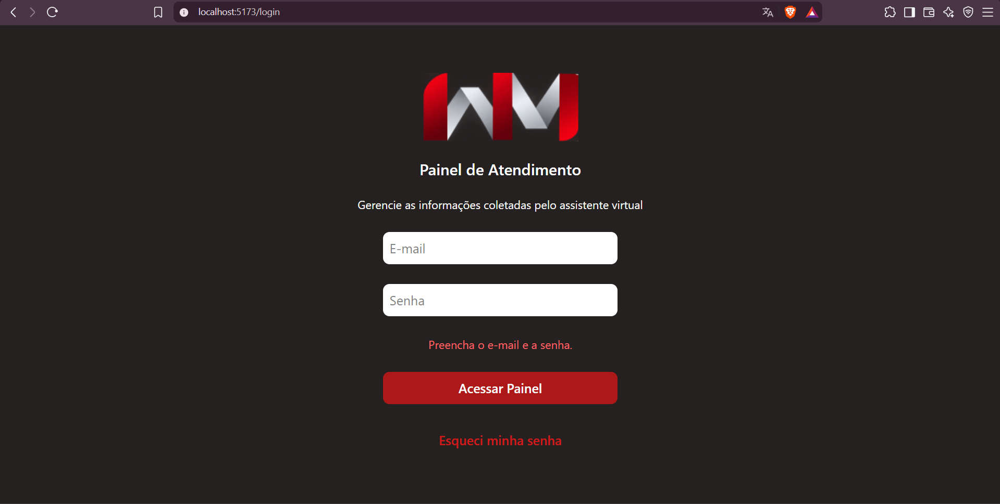
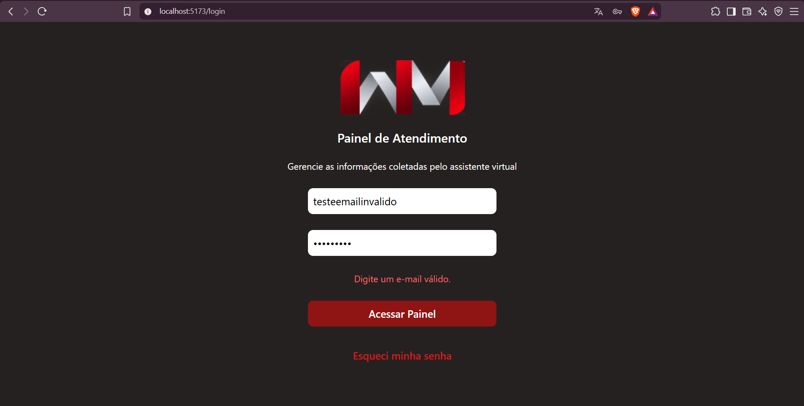
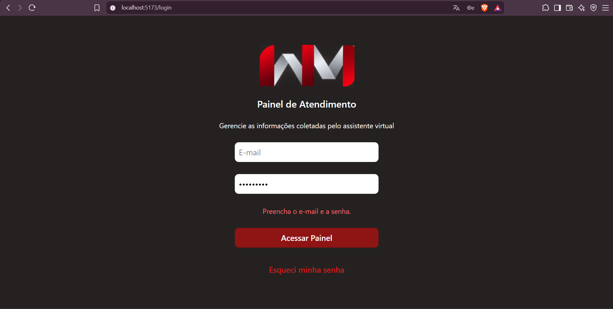
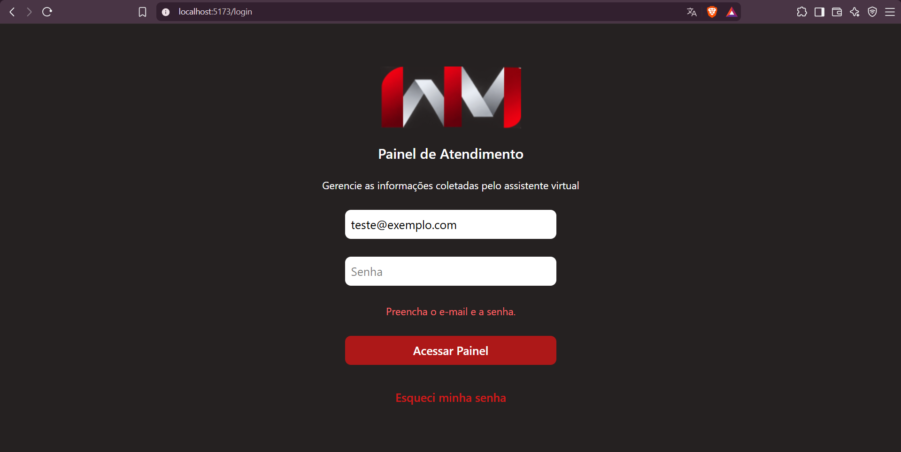
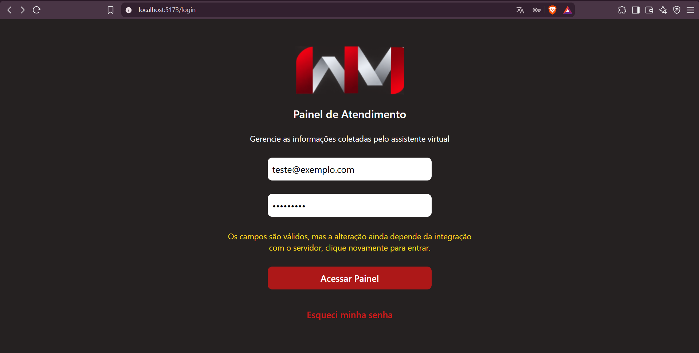
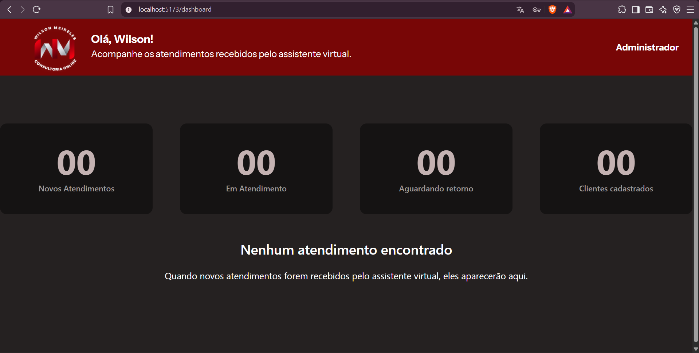

# Relatório de Testes — Issue #85

## 1. Identificação

| Campo | Informação |
|---|---|
| **Issue de desenvolvimento** | #85 — [Frontend] Validar os campos e o feedback do Login |
| **Issue de QA** | #128 |
| **Branch testada** | `feature/85-validacao-login` |
| **Commit testado** | `503ad1d` |
| **Responsável pelos testes** | Lizandra |
| **Data da execução** | 01/11/2026 |
| **Ambiente** | Frontend React/Vite — navegador Brave |
| **URL de teste** | `http://localhost:5173/login` |
| **Requisitos relacionados** | RF-018, RNF-001 e RNF-009 |
| **Resultado geral** | ⚠️ Aprovado com ressalvas |

---

## 2. Objetivo

Validar o comportamento dos campos de e-mail e senha da tela de login, verificando o bloqueio de envios inválidos, a apresentação de mensagens de feedback e o tratamento de dados corretamente preenchidos.

A avaliação também considera a clareza das mensagens apresentadas ao usuário e a consistência visual do formulário.

A autenticação real não faz parte do escopo desta validação, pois depende da integração com o backend.

---

## 3. Ambiente e preparação

### Ambiente utilizado

- **Sistema:** Frontend do Painel de Atendimento.
- **Tecnologia:** React com Vite.
- **Navegador:** Brave.
- **Servidor local:** `http://localhost:5173`.
- **Branch:** `feature/85-validacao-login`.
- **Commit:** `503ad1d`.

### Preparação

O repositório foi atualizado e a branch de desenvolvimento foi selecionada para execução dos testes.

```bash
git fetch origin
git switch --detach origin/feature/85-validacao-login
```

Em seguida, o frontend foi iniciado:

```bash
cd frontend
npm run dev
```

O servidor Vite iniciou corretamente na porta `5173`, permitindo acessar a tela de login.

---

## 4. Casos de teste

### QA-085-01 — Validação dos campos obrigatórios

**Objetivo:**  
Verificar se o formulário impede o envio quando os campos de e-mail e senha estão vazios.

**Procedimento:**

1. Acessar a tela de login.
2. Manter os campos de e-mail e senha vazios.
3. Clicar no botão "Acessar Painel".
4. Observar o comportamento do formulário.

**Resultado esperado:**  
O formulário deve impedir o envio, apresentar uma mensagem de validação compreensível e permanecer na tela de login.

**Resultado obtido:**  
O formulário impediu o envio e apresentou a mensagem:

> Preencha o e-mail e a senha.

A mensagem foi exibida em vermelho, abaixo dos campos de entrada. O usuário permaneceu na tela de login, sem redirecionamento para o Dashboard.

Os campos não receberam destaque visual individual, mas a mensagem apresentada foi suficiente para identificar a necessidade de preenchimento.

**Status:** ✅ Aprovado

**Evidência:**



---

### QA-085-02 — Validação do formato do e-mail

**Objetivo:**  
Verificar se o formulário identifica um endereço de e-mail com formato inválido.

**Procedimento:**

1. Acessar a tela de login.
2. Preencher o campo de e-mail com `testeemailinvalido`.
3. Preencher o campo de senha com `Teste123@`.
4. Clicar em "Acessar Painel".
5. Observar o comportamento do formulário.

**Resultado esperado:**  
O formulário deve identificar o formato inválido do e-mail, impedir o envio e apresentar feedback de validação.

**Resultado obtido:**  
O sistema identificou o endereço de e-mail inválido e apresentou o comportamento esperado, conforme a execução do teste.

O formulário não permitiu a continuidade do fluxo com o endereço informado.

**Status:** ✅ Aprovado

**Evidência:**



---

### QA-085-03 — Validação individual dos campos obrigatórios

**Objetivo:**  
Verificar se o formulário identifica individualmente os campos obrigatórios não preenchidos e apresenta mensagens adequadas.

**Procedimento:**

1. Deixar o campo de e-mail vazio e preencher a senha.
2. Clicar em "Acessar Painel".
3. Observar a mensagem apresentada.
4. Preencher o e-mail com `teste@exemplo.com` e deixar a senha vazia.
5. Clicar novamente em "Acessar Painel".
6. Observar a mensagem apresentada.

**Resultado esperado:**  
O formulário deve impedir o envio nos dois cenários e apresentar uma mensagem clara, indicando qual campo obrigatório precisa ser preenchido.

**Resultado obtido:**  
O formulário impediu corretamente o envio nos dois cenários.

Entretanto, apresentou a mesma mensagem utilizada quando ambos os campos estavam vazios:

> Preencha o e-mail e a senha.

A mensagem não identifica individualmente o campo que precisa ser preenchido.

Embora o bloqueio funcione corretamente, o feedback poderia ser mais específico para facilitar a identificação do campo pendente.

**Status:** ⚠️ Aprovado com ressalva

**Severidade da observação:** Baixa.

**Evidências:**

**E-mail vazio:**



**Senha vazia:**



**Sugestão de melhoria:**

Apresentar mensagens específicas conforme o campo não preenchido:

- E-mail vazio: "Preencha o e-mail."
- Senha vazia: "Preencha a senha."
- Ambos vazios: "Preencha o e-mail e a senha."

---

### QA-085-04 — Comportamento com dados válidos

**Objetivo:**  
Verificar o comportamento do formulário quando os campos de e-mail e senha são preenchidos corretamente.

**Procedimento:**

1. Acessar a tela de login.
2. Preencher o e-mail com `teste@exemplo.com`.
3. Preencher a senha com `Teste123@`.
4. Clicar em "Acessar Painel".
5. Observar o feedback apresentado.
6. Clicar novamente em "Acessar Painel".
7. Verificar o redirecionamento.

**Resultado esperado:**  
O formulário deve reconhecer os campos como válidos e apresentar feedback coerente com o estágio atual da implementação.

Como a autenticação real depende da integração com o backend, o comportamento provisório deve ser comunicado ao usuário.

**Resultado obtido:**  
O sistema reconheceu os dados como válidos e apresentou a mensagem:

> Os campos são válidos, mas a alteração ainda depende da integração com o servidor, clique novamente para entrar.

A mensagem foi exibida em amarelo, diferenciando-se visualmente das mensagens de erro.

Após o segundo clique no botão "Acessar Painel", o sistema redirecionou o usuário para `/dashboard`.

O comportamento corresponde ao fluxo provisório implementado no frontend para permitir a navegação enquanto a autenticação real não está integrada.

**Status:** ✅ Aprovado com observação

**Observação:**  
O redirecionamento atual não representa autenticação real. A integração com o backend deverá substituir o fluxo provisório antes da disponibilização do sistema em ambiente de produção.

**Evidências:**

**Feedback com dados válidos:**



**Redirecionamento para o Dashboard:**



---

## 5. Resumo dos resultados

Foram executados **4 casos de teste**, abrangendo a validação dos campos obrigatórios, o formato do e-mail, as mensagens individuais de preenchimento e o comportamento com dados válidos.

| Caso | Descrição | Resultado |
|---|---|---|
| QA-085-01 | Validação dos campos obrigatórios | ✅ Aprovado |
| QA-085-02 | Validação do formato do e-mail | ✅ Aprovado |
| QA-085-03 | Validação individual dos campos obrigatórios | ⚠️ Aprovado com ressalva |
| QA-085-04 | Comportamento com dados válidos | ✅ Aprovado com observação |

### Consolidado

- **Total de casos executados:** 4
- **Aprovados sem ressalvas:** 2
- **Aprovados com ressalva:** 1
- **Aprovados com observação:** 1
- **Reprovados:** 0
- **Não executados:** 0

---

## 6. Achados e observações

### OBS-085-01 — Mensagem genérica para campos obrigatórios

**Descrição:**  
Quando apenas o e-mail ou apenas a senha está vazio, o formulário apresenta a mensagem "Preencha o e-mail e a senha", independentemente de qual campo precisa ser preenchido.

**Impacto:** Baixo.

**Comportamento esperado:**  
Apresentar feedback específico para o campo obrigatório não preenchido.

**Comportamento observado:**  
O envio é bloqueado corretamente, mas a mensagem permanece genérica.

**Recomendação:**  
Ajustar as mensagens para identificar individualmente os campos pendentes.

**Caso relacionado:** QA-085-03.

---

### OBS-085-02 — Autenticação pendente de integração

**Descrição:**  
O frontend apresenta feedback informando que os campos estão válidos, mas que a integração com o servidor ainda está pendente.

Após o segundo clique, ocorre o redirecionamento para o Dashboard.

**Impacto:** Dependência de integração.

**Classificação:** Observação — fora do escopo da validação dos campos.

**Recomendação:**  
Quando a autenticação estiver integrada, substituir o fluxo provisório pelo processo de autenticação real, condicionando o acesso ao Dashboard à confirmação do backend.

**Caso relacionado:** QA-085-04.

---

## 7. Conclusão

A implementação da issue #85 apresentou funcionamento satisfatório nos cenários executados.

O formulário bloqueou corretamente o envio com campos obrigatórios vazios e identificou o formato inválido de e-mail.

Com dados válidos, apresentou feedback informando a dependência da integração com o servidor e permitiu a navegação provisória para o Dashboard.

Foi identificada uma ressalva relacionada à precisão das mensagens de validação: quando apenas um campo obrigatório está vazio, o sistema apresenta uma mensagem genérica que menciona ambos os campos.

Essa inconsistência não impede o bloqueio do formulário, mas representa uma oportunidade de melhoria na experiência do usuário.

A autenticação real não foi validada nesta execução, pois depende de implementação e integração com o backend.

### Resultado final

**⚠️ APROVADO COM RESSALVAS**

A implementação atende aos principais cenários de validação dos campos testados, com recomendação de aprimoramento das mensagens individuais de preenchimento.

A conclusão limita-se aos quatro casos executados e não representa aprovação da autenticação real ou da autorização de acesso ao Dashboard.

---

## 8. Referências

- **Issue de desenvolvimento:** #85
- **Issue de QA:** #128
- **Branch validada:** `feature/85-validacao-login`
- **Commit validado:** `503ad1d`
- **Diretório de evidências:** `docs/qa/evidencias/issue-85/`
