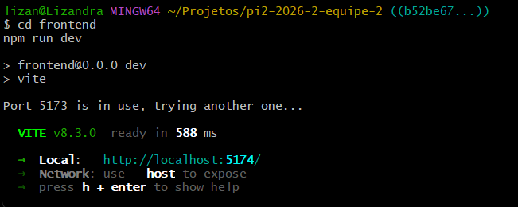
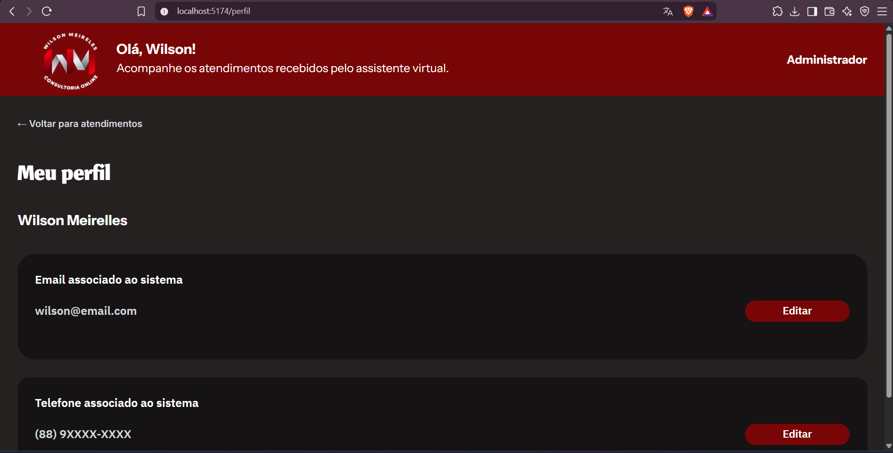
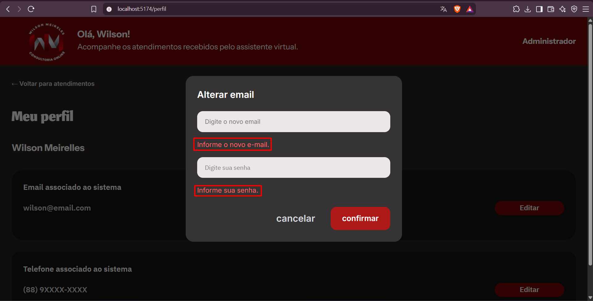
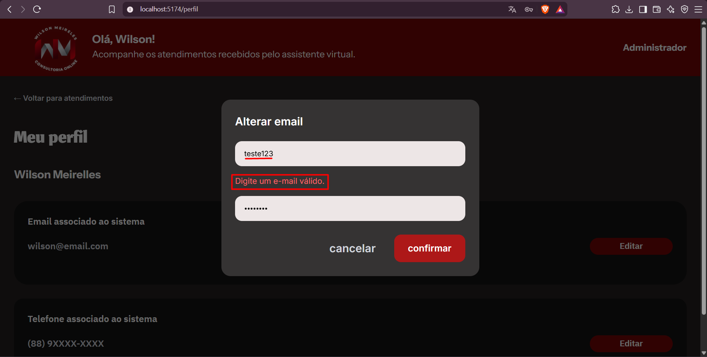
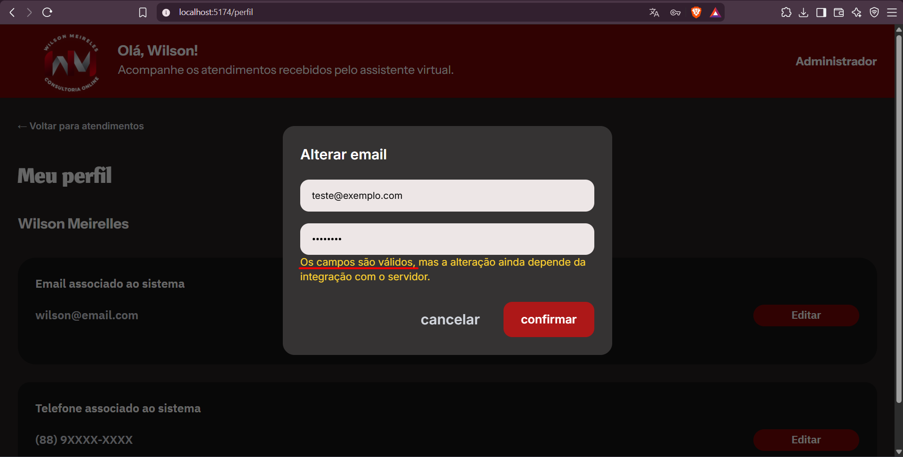
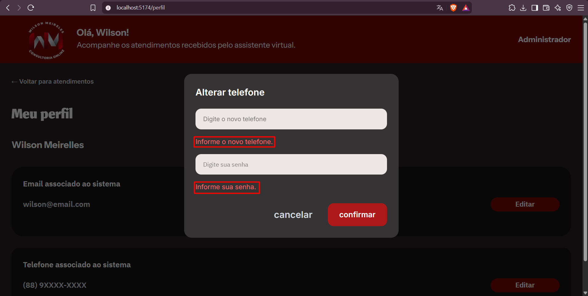
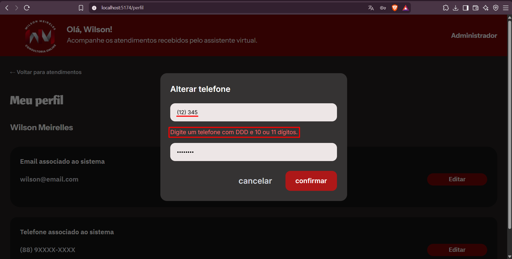

# Relatório de QA — Issue #88

## 1. Identificação

- **Issue:** #88 — [Frontend] Validar o formulário de edição do Perfil
- **Desenvolvedor:** marcio656
- **Branch testada:** `feature/88-validar-formulario-perfil`
- **Commit testado:** `b52be67`
- **Responsável pela validação:** QA
- **Tipo de teste:** Funcional e interface
- **Resultado geral:** Aprovado com ressalva de integração pendente

---

## 2. Objetivo

Validar os formulários de edição de e-mail e telefone da tela de Perfil do Administrador, verificando o preenchimento dos campos obrigatórios, a validação dos formatos informados, a apresentação das mensagens de erro e o comportamento da interface diante de dados válidos.

A validação considera os critérios de aceitação definidos na issue #88, respeitando a limitação de que a integração com a API de atualização do perfil ainda não está disponível.

---

## 3. Critérios de aceitação

- Os campos obrigatórios impedem a submissão quando estão vazios.
- E-mail e telefone são validados conforme as regras definidas.
- As mensagens de erro são claras e associadas ao campo correspondente.
- A interface não informa que os dados foram salvos antes da confirmação do backend.
- Falhas da API são apresentadas sem expor detalhes internos.
- A implementação segue o padrão visual existente.

**Observação:** O tratamento de falhas reais da API não pôde ser executado devido à ausência da integração com o backend.

---

## 4. Ambiente e preparação

- **Ambiente:** Desenvolvimento local
- **Frontend:** React com Vite
- **Navegador:** Brave
- **Endereço:** `http://localhost:5174`
- **Rota testada:** `/perfil`

O frontend foi iniciado utilizando `npm run dev`. Como a porta 5173 estava ocupada, o Vite iniciou automaticamente na porta 5174, sem erros.

A implementação foi testada diretamente na branch do desenvolvedor, em modo detached HEAD, sem alterações no código-fonte.

---

## 5. Casos de teste executados

### QA-088-01 — Inicialização do frontend

**Objetivo:** Verificar se o frontend inicia corretamente após a implementação.

**Procedimento:**
1. Acessar o diretório `frontend`.
2. Executar `npm run dev`.
3. Verificar a inicialização do servidor.

**Resultado esperado:**

O frontend deve iniciar sem apresentar erros.

**Resultado obtido:**

O Vite iniciou corretamente na porta 5174, sem erros de inicialização.

**Status:** Aprovado.

**Evidência:**

---

### QA-088-02 — Renderização da tela de Perfil

**Objetivo:** Verificar a apresentação dos elementos da tela de Perfil.

**Procedimento:**
1. Acessar `/perfil`.
2. Verificar a identificação do administrador.
3. Verificar as informações de e-mail e telefone.
4. Verificar a presença dos botões de edição.

**Resultado esperado:**

A tela deve apresentar os dados do administrador e disponibilizar os controles necessários para editar e-mail e telefone, seguindo o padrão visual existente.

**Resultado obtido:**

A tela apresentou o nome do administrador, o e-mail e o telefone associados ao sistema, além dos respectivos botões "Editar". A estrutura visual apresentou-se consistente com os demais elementos da aplicação.

**Status:** Aprovado.

**Evidência:**

---

### QA-088-03 — Validação dos campos obrigatórios do e-mail

**Objetivo:** Verificar se o formulário impede a confirmação quando os campos obrigatórios estão vazios.

**Procedimento:**
1. Clicar em "Editar" na seção de e-mail.
2. Manter os campos de novo e-mail e senha vazios.
3. Clicar em "confirmar".
4. Verificar as mensagens apresentadas.

**Resultado esperado:**

O sistema deve impedir a confirmação e apresentar mensagens claras para os campos obrigatórios.

**Resultado obtido:**

O formulário apresentou as mensagens "Informe o novo e-mail." e "Informe sua senha.", associadas aos respectivos campos. O modal permaneceu aberto.

**Status:** Aprovado.

**Evidência:**

---

### QA-088-04 — Validação de formato de e-mail inválido

**Objetivo:** Verificar se o formulário rejeita um endereço de e-mail com formato inválido.

**Procedimento:**
1. Abrir o formulário de edição de e-mail.
2. Preencher o e-mail com `teste123`.
3. Preencher a senha.
4. Clicar em "confirmar".

**Resultado esperado:**

O sistema deve impedir a confirmação e apresentar uma mensagem informando que o e-mail possui formato inválido.

**Resultado obtido:**

O sistema apresentou a mensagem "Digite um email válido", impedindo a confirmação.

**Status:** Aprovado.

**Evidência:**

---

### QA-088-05 — Validação de e-mail válido e feedback da operação

**Objetivo:** Verificar o comportamento do formulário ao receber dados válidos, sem simular uma atualização concluída.

**Procedimento:**
1. Abrir o formulário de edição de e-mail.
2. Preencher o e-mail com `teste@exemplo.com`.
3. Preencher a senha.
4. Clicar em "confirmar".
5. Verificar o feedback apresentado.

**Resultado esperado:**

O sistema deve reconhecer os dados válidos, mas não informar que a alteração foi salva sem confirmação do backend.

**Resultado obtido:**

O sistema apresentou a mensagem:

"Os campos são válidos, mas a alteração ainda depende da integração com o servidor."

O modal permaneceu aberto e o e-mail apresentado no perfil não foi alterado.

**Status:** Aprovado.

**Evidência:**

---

### QA-088-06 — Validação dos campos obrigatórios do telefone

**Objetivo:** Verificar se o formulário de edição de telefone impede a confirmação com campos obrigatórios vazios.

**Procedimento:**
1. Abrir o formulário de edição de telefone.
2. Manter os campos de telefone e senha vazios.
3. Clicar em "confirmar".
4. Verificar as mensagens apresentadas.

**Resultado esperado:**

O sistema deve impedir a confirmação e apresentar mensagens de validação nos campos obrigatórios.

**Resultado obtido:**

O formulário apresentou avisos de preenchimento obrigatório para os campos, impedindo a confirmação.

**Status:** Aprovado.

**Evidência:**

---

### QA-088-07 — Validação de formato de telefone inválido

**Objetivo:** Verificar se o formulário rejeita um telefone que não atende ao formato esperado.

**Procedimento:**
1. Abrir o formulário de edição de telefone.
2. Preencher o telefone com `12345`.
3. Preencher a senha.
4. Clicar em "confirmar".

**Resultado esperado:**

O sistema deve impedir a confirmação e apresentar uma mensagem sobre o formato exigido para o telefone.

**Resultado obtido:**

O sistema apresentou a mensagem "Digite um telefone com DDD e 10 ou 11 dígitos.", mantendo o modal aberto.

**Status:** Aprovado.

**Evidência:**

---

### QA-088-08 — Validação de telefone válido e feedback da operação

**Objetivo:** Verificar se o formulário reconhece um telefone válido e evita simular uma alteração concluída.

**Procedimento:**
1. Abrir o formulário de edição de telefone.
2. Preencher o telefone com `88999999999`.
3. Preencher a senha.
4. Clicar em "confirmar".
5. Verificar o comportamento da interface.

**Resultado esperado:**

O sistema deve aceitar o formato do telefone e apresentar um feedback coerente, sem informar que os dados foram salvos antes da confirmação do backend.

**Resultado obtido:**

O formulário aceitou o formato informado e apresentou o aviso de que a alteração depende da integração com o servidor, sem confirmar o salvamento.

**Status:** Aprovado.

**Evidência:**

---

## 6. Resumo da execução

| Indicador | Quantidade |
|---|---:|
| Casos executados | 8 |
| Aprovados | 8 |
| Reprovados | 0 |
| Defeitos funcionais identificados | 0 |
| Critérios não testáveis no ambiente atual | 1 |

**Resultado geral:** Aprovado com ressalva de integração pendente.

---

## 7. Defeitos e observações

### Defeitos identificados

Não foram identificados defeitos funcionais durante a execução dos oito casos de teste.

### OBS-088-01 — Tratamento de falhas da API não validado

**Critério relacionado:** Apresentação de falhas da API sem exposição de detalhes internos.

**Status:** Não testado.

**Descrição:**

A implementação validada ainda não dispõe da integração com o endpoint de atualização do perfil. Dessa forma, não foi possível provocar uma falha real da API e verificar o tratamento da resposta pelo frontend.

**Recomendação:**

Após a disponibilização da integração, executar testes envolvendo respostas de erro da API, verificando se as mensagens apresentadas são compreensíveis e não expõem detalhes internos do servidor.

Esta observação não representa um defeito confirmado na implementação atual.

---

## 8. Considerações finais

A implementação da issue #88 apresentou funcionamento satisfatório nos testes realizados.

Os formulários de edição de e-mail e telefone impediram confirmações com campos obrigatórios vazios ou formatos inválidos, apresentando mensagens claras e associadas aos respectivos campos.

Nos cenários com dados válidos, a interface informou corretamente que a alteração depende da integração com o servidor, sem apresentar uma confirmação indevida de salvamento.

Foram executados **8 casos de teste, todos aprovados**, sem identificação de defeitos funcionais.

O tratamento de falhas reais da API permanece pendente de validação devido à indisponibilidade da integração no ambiente testado.

Dessa forma, a issue #88 recebe o resultado **Aprovado com ressalva de integração pendente**, considerando o escopo de validação local dos formulários.

Recomenda-se complementar os testes de integração quando o endpoint de atualização do perfil estiver disponível.
