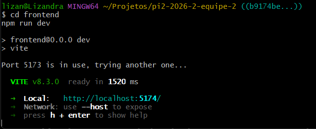
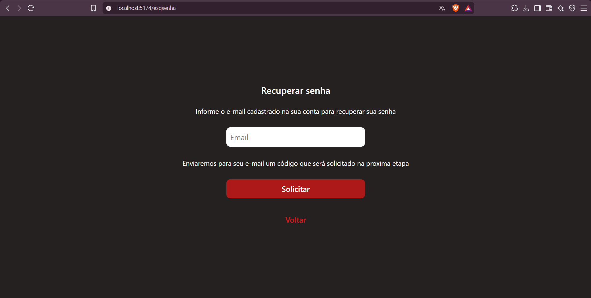
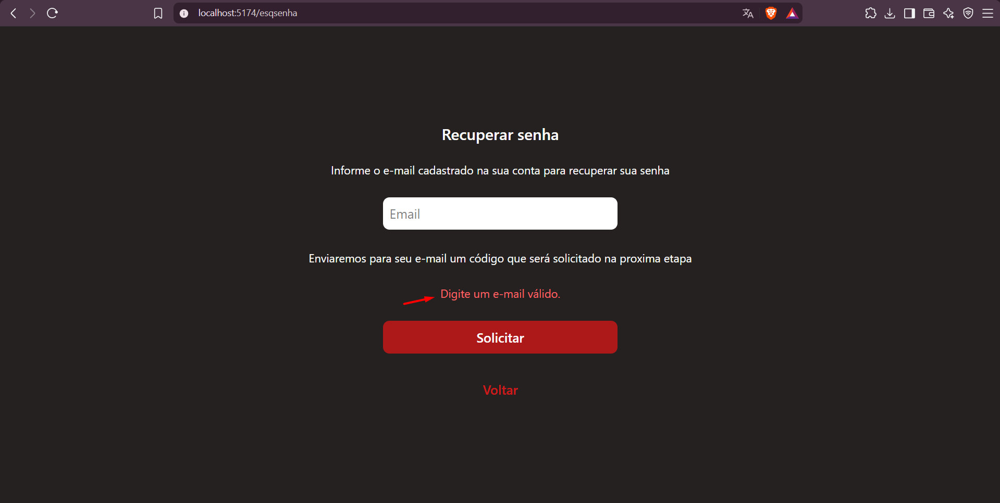
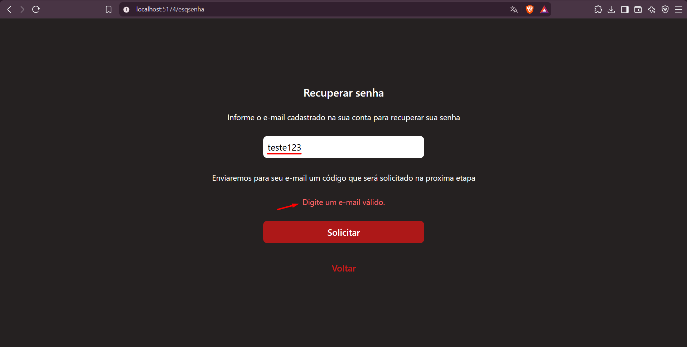
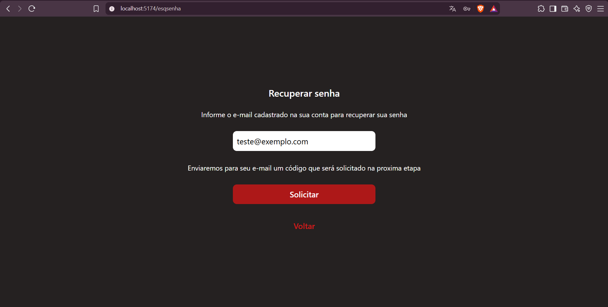
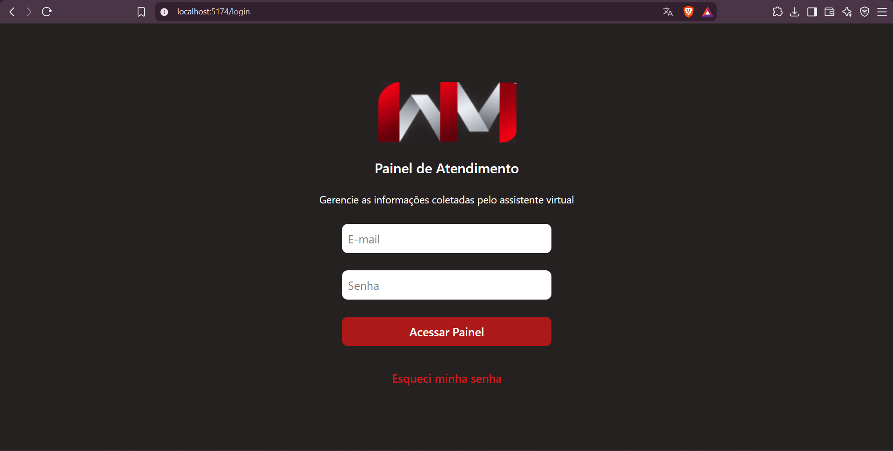
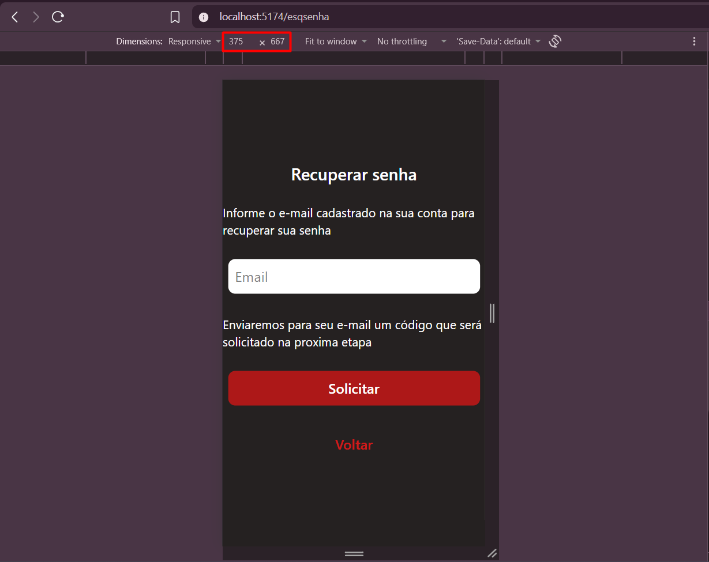
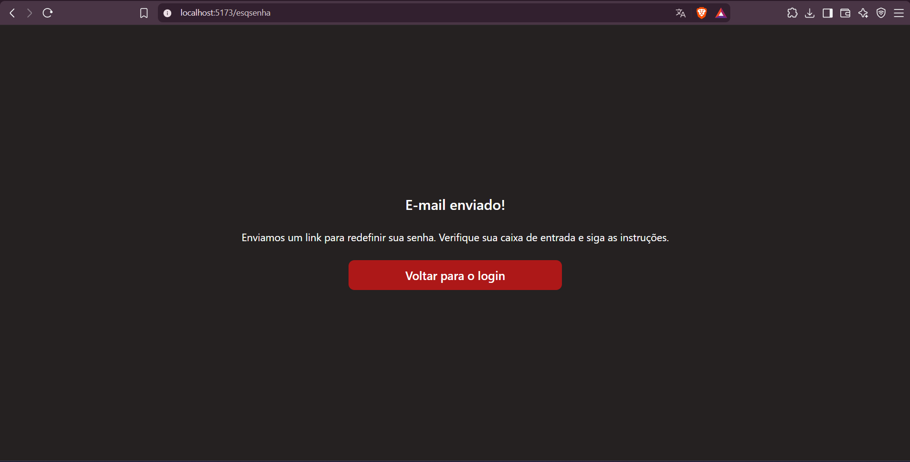
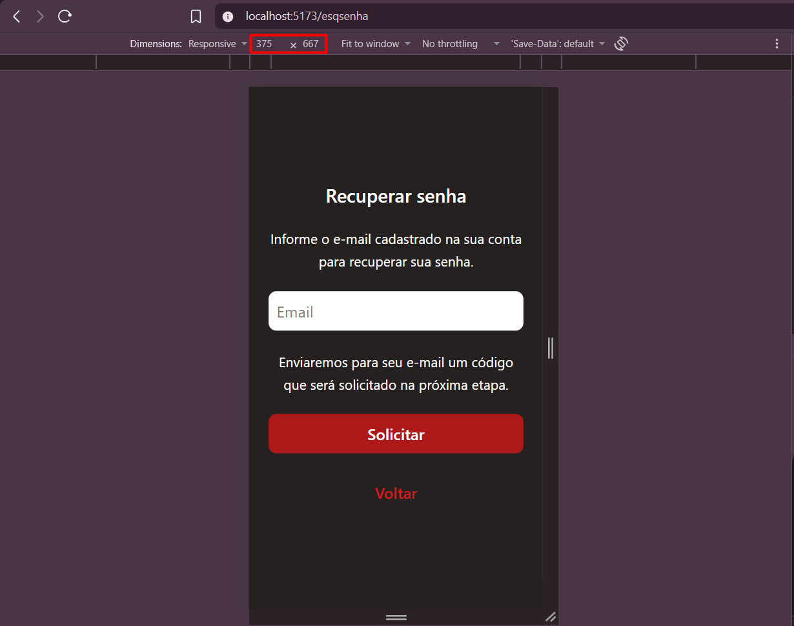

# Relatório de QA — Issue #97

## 1. Identificação

- **Issue:** #97 — [Frontend] Criar tela de recuperação de senha
- **Desenvolvedor:** qw-tf
- **Branch testada:** `feat/tela-recuperacao-senha`
- **Commit da validação inicial:** `b9174be`
- **Commit do reteste:** `fd280c1`
- **Responsável pela validação:** QA
- **Tipo de teste:** Funcional, interface e responsividade
- **Resultado inicial:** Reprovado — necessita correção
- **Resultado geral atualizado:** Aprovado no reteste

---

## 2. Objetivo

Validar a implementação da tela de recuperação de senha, verificando a navegação a partir do Login, a renderização dos elementos da interface, a validação do campo de e-mail, o comportamento da solicitação, o retorno à tela de Login e a responsividade.

A validação considera os critérios de aceitação definidos na issue #97, sem exigir a implementação do envio real de e-mails, geração de tokens ou redefinição efetiva da senha, que não fazem parte do escopo desta atividade.

Após a identificação de um defeito funcional e de uma observação visual na primeira execução, foi realizado um reteste para verificar as correções implementadas.

---

## 3. Critérios de aceitação

- O link "Esqueci minha senha" abre corretamente a nova tela.
- A página apresenta o formulário e os elementos visuais previstos.
- O formulário impede o envio quando o e-mail está vazio ou possui formato inválido.
- As mensagens de validação são claras e consistentes com as demais telas.
- A opção de voltar retorna à tela de Login.
- A tela funciona em diferentes tamanhos, sem cortes ou rolagem horizontal indesejada.
- A interface não informa que as instruções de recuperação foram enviadas sem confirmação real da operação.
- O frontend compila sem erros após a implementação.

---

## 4. Ambiente e preparação

- **Ambiente:** Desenvolvimento local
- **Frontend:** React com Vite
- **Navegador:** Brave
- **Endereço da validação inicial:** `http://localhost:5174`
- **Endereço do reteste:** `http://localhost:5173`
- **Rota testada:** `/esqsenha`
- **Resolução mobile testada:** 375 × 667 px

O frontend foi iniciado utilizando o comando `npm run dev`.

Na validação inicial, como a porta 5173 estava ocupada, o Vite iniciou automaticamente na porta 5174, sem apresentar erros de inicialização.

No reteste, o frontend foi executado na porta 5173.

A implementação foi testada diretamente na branch do desenvolvedor, em modo detached HEAD, sem alterações no código-fonte.

---

## 5. Casos de teste executados — Validação inicial

### QA-097-01 — Inicialização do frontend

**Objetivo:** Verificar se o frontend inicia corretamente após a implementação.

**Procedimento:**
1. Acessar o diretório `frontend`.
2. Executar `npm run dev`.
3. Verificar a inicialização do servidor de desenvolvimento.

**Resultado esperado:**

O frontend deve iniciar sem apresentar erros.

**Resultado obtido:**

O Vite iniciou corretamente na porta 5174, sem erros de inicialização.

**Status:** Aprovado.

**Evidência:**

---

### QA-097-02 — Navegação e renderização da tela

**Objetivo:** Verificar o acesso à tela de recuperação e a apresentação dos elementos previstos.

**Procedimento:**
1. Acessar a tela de Login.
2. Clicar em "Esqueci minha senha".
3. Verificar a rota e os elementos apresentados.

**Resultado esperado:**

O sistema deve abrir a tela de recuperação com título, instruções, campo de e-mail, botão de solicitação e opção de retorno.

**Resultado obtido:**

A tela foi acessada pela rota `/esqsenha`, apresentando os elementos previstos: título "Recuperar senha", instruções, campo de e-mail, botão "Solicitar" e opção "Voltar".

**Status:** Aprovado.

**Evidência:**

---

### QA-097-03 — Validação de e-mail vazio

**Objetivo:** Verificar se o formulário impede solicitações sem preenchimento do e-mail.

**Procedimento:**
1. Acessar a tela de recuperação.
2. Manter o campo de e-mail vazio.
3. Clicar em "Solicitar".
4. Verificar a mensagem apresentada.

**Resultado esperado:**

O formulário deve impedir o prosseguimento e apresentar uma mensagem de validação.

**Resultado obtido:**

O sistema apresentou a mensagem "Digite um e-mail válido.", permanecendo na mesma tela.

**Status:** Aprovado.

**Evidência:**

---

### QA-097-04 — Validação de e-mail inválido

**Objetivo:** Verificar o tratamento de um endereço de e-mail com formato inválido.

**Procedimento:**
1. Acessar a tela de recuperação.
2. Preencher o campo com `teste123`.
3. Clicar em "Solicitar".
4. Verificar a mensagem apresentada.

**Resultado esperado:**

O formulário deve impedir o prosseguimento e informar que o endereço de e-mail possui formato inválido.

**Resultado obtido:**

O sistema apresentou a mensagem "Digite um e-mail válido.", impedindo o prosseguimento da solicitação.

**Status:** Aprovado.

**Evidência:**

---

### QA-097-05 — Solicitação com e-mail válido

**Objetivo:** Verificar o comportamento do formulário ao receber um endereço de e-mail válido.

**Procedimento:**
1. Acessar a tela de recuperação.
2. Preencher o campo com `teste@exemplo.com`.
3. Clicar em "Solicitar".
4. Observar o comportamento da interface.
5. Verificar possíveis erros no Console do navegador.

**Resultado esperado:**

A interface deve apresentar um feedback coerente sobre a solicitação, sem informar que um e-mail foi enviado sem confirmação real da operação.

**Resultado obtido na validação inicial:**

Após clicar em "Solicitar", a interface permaneceu sem alterações visíveis, não apresentando mensagem de confirmação, erro ou orientação. Não foram observados erros JavaScript no Console.

**Status inicial:** Reprovado.

**Defeito relacionado:** DEF-097-01.

**Evidência da validação inicial:**

**Atualização:** O comportamento foi corrigido no commit `fd280c1`, conforme detalhado na seção 9.

**Status após reteste:** Aprovado no reteste.

---

### QA-097-06 — Retorno à tela de Login

**Objetivo:** Verificar se a opção "Voltar" retorna corretamente à tela de Login.

**Procedimento:**
1. Acessar a tela de recuperação.
2. Clicar em "Voltar".
3. Verificar a navegação.

**Resultado esperado:**

O sistema deve retornar à rota `/login`.

**Resultado obtido:**

A opção "Voltar" retornou corretamente à tela de Login.

**Status:** Aprovado.

**Evidência:**

---

### QA-097-07 — Responsividade da tela

**Objetivo:** Verificar a apresentação e a utilização da interface em uma resolução de dispositivo móvel.

**Procedimento:**
1. Abrir a tela de recuperação.
2. Ativar o modo responsivo do navegador.
3. Configurar a resolução de 375 × 667 px.
4. Verificar textos, campo de e-mail, botões e disposição dos elementos.

**Resultado esperado:**

A interface deve permanecer utilizável, sem cortes ou rolagem horizontal indesejada.

**Resultado obtido na validação inicial:**

Os elementos principais permaneceram visíveis e utilizáveis, sem cortes evidentes ou rolagem horizontal indesejada.

Entretanto, foram identificadas inconsistências no alinhamento dos textos, ausência de margens laterais adequadas e espaçamentos que prejudicavam a apresentação visual em dispositivos móveis.

**Status inicial:** Aprovado com observação.

**Observação relacionada:** OBS-097-01.

**Evidência da validação inicial:**

**Atualização:** Os ajustes visuais foram verificados novamente no commit `fd280c1`, conforme detalhado na seção 9.

**Status após reteste:** Aprovado.

---

## 6. Resumo da execução

### 6.1 Validação inicial

| Indicador | Quantidade |
|---|---:|
| Casos executados | 7 |
| Aprovados | 5 |
| Aprovados com observação | 1 |
| Reprovados | 1 |
| Defeitos funcionais identificados | 1 |
| Observações visuais | 1 |

**Resultado inicial:** Reprovado — necessita correção.

### 6.2 Reteste

| Verificação | Resultado |
|---|---|
| QA-097-05 — Solicitação com e-mail válido | Aprovado no reteste |
| QA-097-07 — Responsividade mobile | Aprovado no reteste |
| DEF-097-01 — Ausência de feedback | Corrigido |
| OBS-097-01 — Ajustes visuais mobile | Resolvida |

**Resultado geral atualizado:** Aprovado no reteste.

Os resultados da primeira execução foram preservados para manter o histórico da validação.

---

## 7. Defeitos e observações

### DEF-097-01 — Ausência de feedback na solicitação com e-mail válido

**Caso relacionado:** QA-097-05  
**Severidade:** Média  
**Status inicial:** Pendente de correção  
**Status atualizado:** Corrigido no reteste — commit `fd280c1`

**Descrição:**

Ao preencher um endereço de e-mail válido e clicar em "Solicitar", a interface não apresentava nenhuma resposta visível ao usuário.

**Comportamento esperado:**

A interface deveria apresentar um feedback coerente com o estado da operação.

**Comportamento observado inicialmente:**

O formulário permanecia sem alterações visíveis, sem apresentar confirmação, mensagem de erro ou orientação.

**Recomendação inicial:**

Implementar um feedback adequado para a solicitação, considerando que o envio real de e-mail e a redefinição efetiva da senha não fazem parte do escopo desta issue.

**Resultado do reteste:**

O botão "Solicitar" passou a direcionar para a nova tela de confirmação de e-mail, incluída no protótipo atualizado pela equipe de design.

O defeito relacionado à ausência de resposta visível foi corrigido.

**Status final:** Corrigido.

---

### OBS-097-01 — Ajustes visuais na versão mobile

**Caso relacionado:** QA-097-07  
**Classificação:** Observação visual  
**Status inicial:** Melhoria recomendada  
**Status atualizado:** Resolvida no reteste — commit `fd280c1`

**Descrição:**

Na resolução de 375 × 667 px, a interface permanecia utilizável, mas apresentava inconsistências de alinhamento e espaçamento.

**Recomendação inicial:**

Padronizar o alinhamento dos textos, adicionar margens laterais adequadas e revisar os espaçamentos verticais para melhorar a apresentação em dispositivos móveis.

**Resultado do reteste:**

A interface apresentou melhorias no alinhamento dos textos, nas margens laterais e nos espaçamentos.

Os elementos permaneceram visíveis e organizados, sem cortes ou rolagem horizontal indesejada na resolução testada.

**Status final:** Resolvida.

---

### Observação técnica adicional

Durante a inspeção pelo DevTools na validação inicial, foram apresentados avisos relacionados a campos de formulário sem atributos `id` ou `name`.

Esses avisos não foram classificados como defeitos funcionais nesta validação, mas podem ser considerados em futuras melhorias de acessibilidade e estrutura dos formulários.

---

## 8. Considerações finais da validação inicial

A implementação da issue #97 apresentou funcionamento satisfatório na inicialização do frontend, navegação, renderização da tela, validação de e-mails vazios e inválidos e retorno ao Login.

A interface também permaneceu utilizável em resolução mobile, embora apresentasse oportunidades de melhoria visual.

Entretanto, foi identificado um defeito funcional no tratamento da solicitação com e-mail válido, pois a interface não apresentava feedback ao usuário após o acionamento do botão "Solicitar".

Dessa forma, a implementação foi **reprovada na validação inicial**, permanecendo pendente a correção do defeito DEF-097-01.

**Atualização após o reteste:** As pendências identificadas na validação inicial foram corrigidas no commit `fd280c1`. O resultado geral foi atualizado para **Aprovado no reteste**, conforme detalhado na seção 9.

---

## 9. Reteste — Issue #97

### 9.1 Identificação do reteste

- **Issue:** #97 — [Frontend] Criar tela de recuperação de senha
- **Desenvolvedor:** qw-tf
- **Branch:** `feat/tela-recuperacao-senha`
- **Commit anterior:** `b9174be`
- **Commit do reteste:** `fd280c1`
- **Tipo de teste:** Reteste funcional e de responsividade
- **Resultado:** Aprovado no reteste

### 9.2 Objetivo

Verificar as correções realizadas após a primeira validação da issue #97, especialmente o funcionamento do botão "Solicitar" com e-mail válido e os ajustes visuais da interface em dispositivos móveis.

O reteste foi realizado considerando a atualização do protótipo, que passou a incluir uma tela de confirmação da solicitação de recuperação de senha.

---

### 9.3 Reteste — QA-097-05: Solicitação com e-mail válido

**Defeito relacionado:** DEF-097-01 — Ausência de feedback na solicitação com e-mail válido.

**Procedimento:**
1. Acessar a rota `/esqsenha`.
2. Preencher o campo com `teste@exemplo.com`.
3. Clicar em "Solicitar".
4. Verificar o comportamento da interface.

**Resultado esperado:**

O botão deve executar a ação prevista no fluxo de recuperação de senha, apresentando o feedback definido no protótipo atualizado.

**Resultado obtido:**

Após clicar em "Solicitar", o sistema apresentou a nova tela de confirmação de e-mail, implementada conforme a atualização realizada pela equipe de design.

A tela apresentou o título "E-mail enviado!", as instruções de recuperação e o botão "Voltar para o login".

O comportamento anterior, no qual o botão não apresentava nenhuma resposta visível, foi corrigido.

**Status:** Aprovado no reteste.

**Defeito:** DEF-097-01 — Corrigido.

**Evidência:**

---

### 9.4 Reteste — QA-097-07: Responsividade mobile

**Observação relacionada:** OBS-097-01 — Ajustes visuais na versão mobile.

**Procedimento:**
1. Acessar a tela de recuperação de senha.
2. Ativar o modo responsivo do navegador.
3. Configurar a resolução de 375 × 667 px.
4. Verificar alinhamento, espaçamento, textos, campo de e-mail e botões.

**Resultado esperado:**

A interface deve apresentar seus elementos de maneira organizada e adaptada à resolução mobile, sem cortes de conteúdo ou rolagem horizontal indesejada.

**Resultado obtido:**

A interface apresentou melhorias no alinhamento e nos espaçamentos dos elementos.

O título e as instruções ficaram centralizados, enquanto o campo de e-mail e os botões apresentaram alinhamento adequado.

Os textos se ajustaram à largura disponível, sem cortes visíveis ou rolagem horizontal indesejada.

**Status:** Aprovado no reteste.

**Observação:** OBS-097-01 — Resolvida.

**Evidência:**

---

### 9.5 Resumo do reteste

| Indicador | Resultado |
|---|---|
| Verificações realizadas | 2 |
| Verificações aprovadas | 2 |
| Defeitos corrigidos | 1 |
| Observações visuais resolvidas | 1 |
| Pendências identificadas no reteste | 0 |

**Resultado:** Aprovado no reteste.

---

### 9.6 Considerações finais do reteste

O reteste realizado no commit `fd280c1` confirmou a correção do defeito DEF-097-01, relacionado à ausência de feedback após a solicitação de recuperação de senha com e-mail válido.

O botão "Solicitar" passou a direcionar para a nova tela de confirmação prevista no protótipo atualizado.

Também foram verificados os ajustes de responsividade na resolução de 375 × 667 px, confirmando melhorias no alinhamento e na disposição dos elementos da interface.

As duas verificações realizadas foram aprovadas, sem identificação de novas pendências no escopo do reteste.

Dessa forma, a implementação da issue #97 recebe o resultado final **Aprovado no reteste**.
