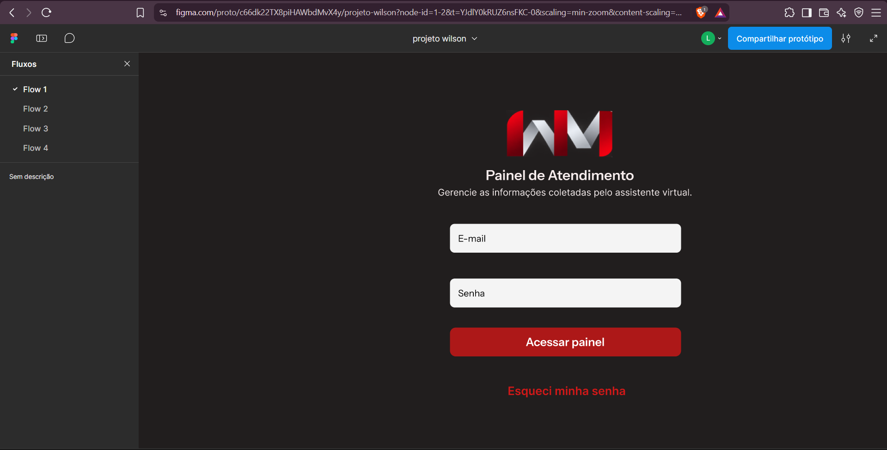

# Relatório de QA — Validação de Usabilidade do Protótipo Atualizado

## 1. Identificação

- **Projeto:** Chatbot Personal Trainer — Projeto Integrador II
- **Equipe:** Equipe 2
- **Atividade:** Validação de usabilidade do protótipo atualizado
- **Responsável pela validação:** QA
- **Ferramenta:** Figma
- **Tipo de teste:** Usabilidade, navegação, interface e consistência visual
- **Resultado geral:** Reprovado — necessita correções

**Protótipo avaliado:** [Projeto Wilson — Figma](https://www.figma.com/design/c66dk22TX8piHAWbdMvX4y/projeto-wilson?node-id=93-283)

---

## 2. Objetivo

Avaliar a usabilidade e a navegabilidade do protótipo atualizado do sistema, verificando a organização das interfaces, a clareza das informações, a consistência visual e o funcionamento das interações configuradas no Figma.

A validação também considera as observações encaminhadas pela equipe de Frontend, buscando identificar problemas que possam dificultar a experiência do usuário ou gerar dúvidas durante a implementação das telas.

Por se tratar de um protótipo navegável, não são exigidos comportamentos dependentes de backend, persistência de dados, autenticação real ou processamento de formulários. Entretanto, as interações representadas devem permitir a compreensão dos principais fluxos do sistema.

---

## 3. Escopo da validação

Foram avaliados os seguintes elementos:

- Tela de Login e apresentação de mensagens de erro.
- Dashboard e organização das informações.
- Tela de detalhes do atendimento.
- Modal de confirmação para assumir atendimento.
- Modal de exclusão de cliente.
- Menu do administrador no Dashboard e na tela de perfil.
- Tela de perfil e navegação de retorno.
- Modal de alteração de e-mail.
- Acesso à edição de telefone.
- Opção de saída do sistema.
- Fluxo de recuperação de senha.
- Retorno à tela de Login.

Também foram consideradas as observações da equipe de Frontend sobre cores, alinhamento, apresentação de mensagens, navegação e identidade visual dos componentes.

---

## 4. Ambiente e preparação

- **Ambiente:** Protótipo navegável no Figma
- **Navegador:** Brave
- **Plataforma:** Desktop
- **Método:** Navegação manual pelos fluxos disponíveis
- **Evidências:** Capturas de tela e duas gravações de vídeo

A validação foi realizada por meio da navegação entre as telas e da inspeção visual dos componentes.

As evidências estáticas foram registradas por capturas de tela. Os comportamentos de cancelamento de exclusão e do menu Administrador no Dashboard foram registrados em vídeo.

---

## 5. Casos de teste executados

### QA-USAB-01 — Tela de Login

**Objetivo:** Verificar a apresentação da tela de Login e a clareza dos elementos disponíveis.

**Procedimento:**
1. Iniciar o protótipo.
2. Acessar a tela de Login.
3. Verificar os campos, botões e textos.
4. Observar a apresentação da mensagem de erro.

**Resultado esperado:**

A tela deve apresentar os elementos necessários para a autenticação de maneira organizada, permitindo identificar os campos de e-mail e senha, a ação de acesso e a recuperação de senha.

**Resultado obtido:**

A tela apresenta o logotipo, o título do sistema, os campos de e-mail e senha, o botão de acesso e a opção de recuperação de senha.

Também foi identificada uma versão da interface com mensagem de credenciais incorretas.

**Status:** Aprovado.

**Evidência:**

---

### QA-USAB-02 — Dashboard e organização das informações

**Objetivo:** Avaliar a organização visual do Dashboard e a apresentação dos atendimentos.

**Procedimento:**
1. Acessar o Dashboard.
2. Verificar os cartões de estatísticas.
3. Observar a lista de clientes recentes.
4. Analisar alinhamentos, espaçamentos e distribuição dos componentes.

**Resultado esperado:**

O Dashboard deve apresentar as informações de maneira organizada, mantendo alinhamento e espaçamento consistentes entre os componentes.

**Resultado obtido:**

O Dashboard apresenta quatro cartões de estatísticas e uma lista de clientes recentes com informações de atendimento, status e ações disponíveis.

Entretanto, foram identificadas inconsistências de alinhamento e distribuição dos elementos, principalmente nos cartões de clientes.

**Status:** Aprovado com observação.

**Observação relacionada:** OBS-USAB-01.

**Evidência:**

---

### QA-USAB-03 — Tela de detalhes do atendimento

**Objetivo:** Avaliar a organização da tela de atendimento e a apresentação do histórico da conversa.

**Procedimento:**
1. Acessar os detalhes de um atendimento.
2. Verificar as informações do cliente.
3. Observar o resumo do atendimento.
4. Analisar a apresentação das mensagens.
5. Verificar os elementos de navegação.

**Resultado esperado:**

A tela deve apresentar as informações do atendimento de maneira clara, permitindo distinguir as mensagens do cliente e do chatbot.

**Resultado obtido:**

A tela apresenta o nome e o telefone do cliente, o resumo do atendimento, o histórico da conversa e a opção de assumir atendimento.

Foram identificadas diferenças na tonalidade do cabeçalho e problemas de alinhamento nos elementos relacionados às mensagens do chatbot.

A organização das mensagens também pode dificultar a leitura sequencial da conversa.

**Status:** Aprovado com observações.

**Observações relacionadas:** OBS-USAB-02, OBS-USAB-03 e OBS-USAB-04.

**Evidência:**

---

### QA-USAB-04 — Modal de confirmação para assumir atendimento

**Objetivo:** Verificar a apresentação e o comportamento do modal de confirmação.

**Procedimento:**
1. Acessar os detalhes de um atendimento.
2. Clicar em "Assumir atendimento".
3. Verificar o modal apresentado.
4. Acionar a opção de cancelamento.
5. Observar a navegação resultante.

**Resultado esperado:**

Ao selecionar "Cancelar", o usuário deve retornar à tela de detalhes do atendimento, sem executar a ação.

**Resultado obtido:**

O modal é apresentado corretamente, mas, ao selecionar "Cancelar", o protótipo retorna ao Dashboard em vez de permanecer na tela de detalhes.

**Status:** Reprovado.

**Defeito relacionado:** DEF-USAB-01.

**Evidência:**

---

### QA-USAB-05 — Modal de exclusão de cliente

**Objetivo:** Verificar o comportamento da confirmação e do cancelamento da exclusão.

**Procedimento:**
1. Acessar o Dashboard.
2. Selecionar a opção de exclusão de um cliente.
3. Verificar a apresentação do modal.
4. Clicar em "Cancelar".
5. Observar a tela apresentada.

**Resultado esperado:**

Ao cancelar, o usuário deve retornar ao Dashboard sem alterações inesperadas na interface.

**Resultado obtido:**

O modal apresenta a identificação do cliente e informa que a exclusão não poderá ser desfeita.

Entretanto, durante o fluxo de cancelamento, os cartões de estatísticas desaparecem do Dashboard.

**Status:** Reprovado.

**Defeito relacionado:** DEF-USAB-02.

**Evidência em vídeo:**

[▶ Assistir — QA-USAB-05: Cancelamento da exclusão]([LINK_DO_DRIVE_QA_USAB_05](https://drive.google.com/file/d/1Vc8f3S36lcWEcuvgPjC0A8tITt5Y5MIG/view?usp=sharing))

---

### QA-USAB-06 — Menu do administrador

**Objetivo:** Verificar a abertura e o comportamento do menu Administrador nas diferentes telas do protótipo.

**Procedimento:**
1. Acessar o Dashboard.
2. Clicar em "Administrador".
3. Observar a interação apresentada.
4. Clicar novamente em "Administrador".
5. Verificar a abertura do menu.
6. Acessar a tela de perfil.
7. Clicar em "Administrador" novamente.
8. Observar o comportamento.

**Resultado esperado:**

O menu deve abrir corretamente no primeiro clique, apresentando as opções disponíveis.

Seu comportamento deve ser consistente entre as telas, sem interferir em outras funcionalidades.

**Resultado obtido:**

No Dashboard, o primeiro clique em "Administrador" direciona indevidamente para a interface de exclusão do cliente Adrian Moreira.

Durante essa interação, também ocorre uma alteração no posicionamento do texto "Administrador".

Somente após um segundo clique o menu é apresentado corretamente, com as opções "Perfil" e "Sair".

Além disso, ao acessar a tela de perfil e clicar em "Administrador", o menu não é aberto e nenhuma interação é apresentada.

**Status:** Reprovado.

**Defeitos relacionados:** DEF-USAB-03 e DEF-USAB-08.

**Evidências:**

[▶ Assistir — QA-USAB-06: Menu do administrador no Dashboard]([LINK_DO_DRIVE_QA_USAB_06](https://drive.google.com/file/d/1MSaisyhqmFvWo6sjmSSJ0fkRg5OcZyGI/view?usp=sharing))

O comportamento do menu na tela de perfil também foi observado durante a navegação manual.

---

### QA-USAB-07 — Tela de perfil do administrador

**Objetivo:** Avaliar a apresentação das informações do administrador e a navegação da tela de perfil.

**Procedimento:**
1. Abrir o menu do administrador.
2. Selecionar "Perfil".
3. Verificar as informações apresentadas.
4. Analisar o alinhamento dos componentes.
5. Procurar uma opção de retorno ao Dashboard.

**Resultado esperado:**

A tela deve apresentar os dados do administrador de maneira organizada e oferecer uma forma clara de retornar à navegação principal.

**Resultado obtido:**

A tela apresenta o nome do administrador, o e-mail, o telefone e os respectivos botões de edição.

Entretanto, foram identificadas inconsistências de alinhamento e espaçamento.

Não foi identificada uma opção visível de retorno ao Dashboard.

O problema é agravado pelo fato de o menu Administrador também não abrir nessa tela, deixando o usuário sem uma alternativa clara de retorno dentro do protótipo.

**Status:** Reprovado.

**Defeitos relacionados:** DEF-USAB-04 e DEF-USAB-08.

**Observação relacionada:** OBS-USAB-05.

**Evidência:**

---

### QA-USAB-08 — Modal de alteração de e-mail

**Objetivo:** Verificar a abertura, a apresentação e o cancelamento do modal de alteração de e-mail.

**Procedimento:**
1. Acessar a tela de perfil.
2. Clicar em "Editar" no campo de e-mail.
3. Verificar os elementos do modal.
4. Selecionar "Cancelar".
5. Abrir novamente o modal.
6. Observar a interação de confirmação.

**Resultado esperado:**

O modal deve apresentar os campos necessários para representar a alteração do e-mail.

A opção "Cancelar" deve fechar o modal e manter o usuário na tela de perfil.

**Resultado obtido:**

O modal apresenta os campos de novo e-mail e senha, além das opções de confirmação e cancelamento.

A opção "Cancelar" fecha o modal corretamente.

O botão "Confirmar" não apresenta uma ação demonstrável. Entretanto, considerando que o protótipo não permite o preenchimento real dos campos, esse comportamento não foi classificado como defeito.

Foram identificadas inconsistências no posicionamento do modal e na apresentação visual do botão secundário.

**Status:** Aprovado com observações.

**Observações relacionadas:** OBS-USAB-06 e OBS-USAB-07.

**Evidência:**

---

### QA-USAB-09 — Edição de telefone

**Objetivo:** Verificar o acesso ao formulário de alteração de telefone.

**Procedimento:**
1. Acessar a tela de perfil.
2. Localizar o campo de telefone.
3. Clicar no botão "Editar".
4. Observar a interação apresentada.

**Resultado esperado:**

O botão deve permitir acessar o formulário ou modal correspondente à alteração de telefone.

**Resultado obtido:**

Ao clicar no botão "Editar" do telefone, nenhuma interação é apresentada.

O usuário permanece na tela de perfil, sem acesso ao formulário correspondente.

**Status:** Reprovado.

**Defeito relacionado:** DEF-USAB-05.

**Evidência:**

---

### QA-USAB-10 — Opção "Sair"

**Objetivo:** Verificar a navegação da opção de saída do sistema.

**Procedimento:**
1. Acessar o menu do administrador.
2. Selecionar "Sair".
3. Observar o comportamento do protótipo.

**Resultado esperado:**

A opção deve direcionar o usuário à tela de Login, representando visualmente a saída do sistema.

**Resultado obtido:**

Ao selecionar "Sair", nenhuma interação é apresentada.

O protótipo permanece na mesma tela, sem demonstrar o fluxo de saída.

**Status:** Reprovado.

**Defeito relacionado:** DEF-USAB-06.

**Evidência:**

---

### QA-USAB-11 — Recuperação de senha

**Objetivo:** Avaliar a navegação e a clareza das informações apresentadas durante a recuperação de senha.

**Procedimento:**
1. Acessar a tela de Login.
2. Clicar em "Esqueci minha senha".
3. Verificar a tela de recuperação.
4. Clicar em "solicitar".
5. Verificar a tela seguinte.

**Resultado esperado:**

O protótipo deve apresentar uma sequência compreensível de recuperação de senha, mantendo consistência entre as instruções das telas.

**Resultado obtido:**

A opção "Esqueci minha senha" direciona corretamente para a tela de recuperação.

Ao selecionar "solicitar", o protótipo apresenta uma tela de confirmação com a mensagem "E-mail enviado!".

Entretanto, foi identificada uma divergência entre as instruções:

- A primeira tela informa que será enviado um código por e-mail.
- A segunda tela informa que foi enviado um link para redefinição da senha.

Também foram identificadas inconsistências de capitalização nos títulos, botões e textos apresentados.

**Status:** Aprovado com observações.

**Observações relacionadas:** OBS-USAB-08 e OBS-USAB-09.

**Evidências:**

---

### QA-USAB-12 — Retorno ao Login após recuperação de senha

**Objetivo:** Verificar o comportamento da opção de retorno à tela de Login.

**Procedimento:**
1. Acessar a tela de confirmação de recuperação de senha.
2. Clicar em "voltar para o login".
3. Observar a tela apresentada.

**Resultado esperado:**

O protótipo deve retornar à tela inicial de Login, sem mensagens de erro relacionadas à autenticação.

**Resultado obtido:**

O botão retorna à tela de Login.

Entretanto, a tela apresentada contém a mensagem de erro de credenciais incorretas, mesmo sem uma tentativa de autenticação.

**Status:** Reprovado.

**Defeito relacionado:** DEF-USAB-07.

**Evidência:**

---

## 6. Resumo da execução

| Indicador | Quantidade |
|---|---:|
| Casos executados | 12 |
| Aprovados | 1 |
| Aprovados com observações | 4 |
| Reprovados | 7 |
| Defeitos de interação e navegação | 8 |
| Observações de usabilidade e interface | 9 |

**Resultado geral: Reprovado — necessita correções.**

A reprovação está relacionada principalmente aos problemas de navegação e às interações que não apresentam o comportamento esperado.

---

## 7. Defeitos identificados

### DEF-USAB-01 — Cancelamento de assumir atendimento direciona ao Dashboard

**Caso relacionado:** QA-USAB-04  
**Severidade:** Média  
**Status:** Pendente de correção

**Descrição:**

Ao selecionar "Cancelar" no modal de confirmação para assumir atendimento, o protótipo direciona o usuário ao Dashboard.

**Comportamento esperado:**

O modal deve ser fechado, mantendo o usuário na tela de detalhes do atendimento.

**Recomendação:**

Ajustar a interação de cancelamento para retornar ao frame de detalhes do atendimento.

---

### DEF-USAB-02 — Desaparecimento dos cartões de estatísticas após cancelamento de exclusão

**Caso relacionado:** QA-USAB-05  
**Severidade:** Média  
**Status:** Pendente de correção

**Descrição:**

Durante o fluxo de cancelamento da exclusão de cliente, o Dashboard é apresentado sem os cartões de estatísticas.

**Comportamento esperado:**

O cancelamento deve preservar a apresentação original do Dashboard.

**Recomendação:**

Revisar as conexões entre os frames do fluxo de exclusão.

---

### DEF-USAB-03 — Comportamento incorreto do menu Administrador no Dashboard

**Caso relacionado:** QA-USAB-06  
**Severidade:** Alta  
**Status:** Pendente de correção

**Descrição:**

O primeiro clique em "Administrador" direciona indevidamente para a interface de exclusão do cliente Adrian Moreira e altera o posicionamento do texto no cabeçalho.

O menu correto aparece somente após uma segunda interação.

**Comportamento esperado:**

O menu deve ser apresentado diretamente no primeiro clique, sem interferir em ações de exclusão.

**Recomendação:**

Revisar as áreas clicáveis e as conexões entre os frames.

---

### DEF-USAB-04 — Ausência de navegação clara para retornar ao Dashboard

**Caso relacionado:** QA-USAB-07  
**Severidade:** Média  
**Status:** Pendente de correção

**Descrição:**

A tela de perfil não apresenta uma opção visível de retorno ao Dashboard.

Além disso, o menu Administrador não abre nessa tela, impossibilitando o retorno por meio desse componente.

**Comportamento esperado:**

O usuário deve conseguir retornar à tela principal por meio de uma opção clara de navegação.

**Recomendação:**

Adicionar uma opção de retorno ao Dashboard e corrigir o funcionamento do menu Administrador na tela de perfil.

---

### DEF-USAB-05 — Botão de edição de telefone sem interação

**Caso relacionado:** QA-USAB-09  
**Severidade:** Média  
**Status:** Pendente de correção

**Descrição:**

O botão "Editar" associado ao telefone não apresenta nenhuma resposta ao clique.

**Comportamento esperado:**

O botão deve abrir o formulário correspondente à alteração de telefone.

**Recomendação:**

Configurar a interação do botão no Figma.

---

### DEF-USAB-06 — Opção "Sair" sem navegação

**Caso relacionado:** QA-USAB-10  
**Severidade:** Média  
**Status:** Pendente de correção

**Descrição:**

A opção "Sair" não apresenta nenhuma resposta ao clique.

**Comportamento esperado:**

O protótipo deve representar a saída do sistema, direcionando à tela de Login.

**Recomendação:**

Configurar a navegação da opção "Sair" para o frame inicial de Login.

---

### DEF-USAB-07 — Mensagem de erro indevida no retorno ao Login

**Caso relacionado:** QA-USAB-12  
**Severidade:** Média  
**Status:** Pendente de correção

**Descrição:**

Ao retornar da confirmação de recuperação de senha, o protótipo apresenta a tela de Login com uma mensagem de credenciais incorretas.

**Comportamento esperado:**

A tela de Login deve ser apresentada sem mensagens de erro quando não houve tentativa de autenticação.

**Recomendação:**

Ajustar a conexão do botão de retorno para o frame inicial de Login.

---

### DEF-USAB-08 — Menu Administrador não abre na tela de perfil

**Caso relacionado:** QA-USAB-06  
**Severidade:** Média  
**Status:** Pendente de correção

**Descrição:**

Ao acessar a tela de perfil do administrador e clicar em "Administrador" no cabeçalho, nenhuma interação é apresentada.

O menu não abre, diferentemente do comportamento esperado para o componente.

**Comportamento esperado:**

O menu deve abrir normalmente, apresentando as opções disponíveis, independentemente da tela em que o usuário esteja.

**Recomendação:**

Configurar a interação do menu Administrador na tela de perfil e padronizar seu comportamento entre as interfaces.

---

## 8. Observações e recomendações

### OBS-USAB-01 — Desalinhamentos no Dashboard

**Caso relacionado:** QA-USAB-02  
**Origem:** QA

Foram identificadas inconsistências de alinhamento e espaçamento entre os componentes dos cartões de clientes recentes.

**Recomendação:** Padronizar a distribuição dos elementos e seus alinhamentos.

---

### OBS-USAB-02 — Diferenças na tonalidade dos cabeçalhos

**Caso relacionado:** QA-USAB-03  
**Origem:** QA e Frontend

Os cabeçalhos apresentam tonalidades diferentes de vermelho entre as telas.

**Recomendação:** Padronizar a cor dos cabeçalhos. A equipe de Frontend sugeriu utilizar o tom mais escuro para proporcionar maior conforto visual.

---

### OBS-USAB-03 — Alinhamento das mensagens do histórico

**Caso relacionado:** QA-USAB-03  
**Origem:** QA e Frontend

A disposição das mensagens e algumas inconsistências de alinhamento dificultam a distinção visual entre as interações do cliente e do chatbot.

**Recomendação:** Revisar a organização das mensagens, utilizando alinhamentos consistentes e diferenciação clara entre os participantes.

---

### OBS-USAB-04 — Ausência de horários nas mensagens

**Caso relacionado:** QA-USAB-03  
**Origem:** Frontend

A equipe de Frontend sugeriu que cada mensagem apresente o horário correspondente.

**Recomendação:** Considerar a inclusão dos horários para facilitar a leitura cronológica do histórico.

---

### OBS-USAB-05 — Organização visual da tela de perfil

**Caso relacionado:** QA-USAB-07  
**Origem:** QA

Foram identificadas inconsistências no alinhamento dos campos e na padronização dos textos apresentados.

**Recomendação:** Revisar os espaçamentos, alinhamentos e a capitalização dos títulos dos campos.

---

### OBS-USAB-06 — Posicionamento do modal de alteração de e-mail

**Caso relacionado:** QA-USAB-08  
**Origem:** QA

O modal aparece deslocado para a direita, diferentemente do padrão centralizado utilizado em outros modais do sistema.

**Recomendação:** Padronizar o posicionamento do modal.

---

### OBS-USAB-07 — Identidade visual dos botões secundários

**Caso relacionado:** QA-USAB-08  
**Origem:** QA e Frontend

Algumas ações, como "Cancelar" e "Sair", são apresentadas apenas como texto, podendo ser interpretadas como links.

**Recomendação:** Definir um padrão visual para botões primários e secundários.

---

### OBS-USAB-08 — Inconsistências na capitalização dos textos

**Caso relacionado:** QA-USAB-11  
**Origem:** QA

Foram identificadas diferenças na capitalização dos textos das telas de recuperação de senha.

**Exemplos:**

- "Recuperar Senha" → "Recuperar senha"
- "solicitar" → "Solicitar"
- "voltar para o login" → "Voltar para o login"
- "enviamos um link..." → "Enviamos um link..."

**Recomendação:** Padronizar a escrita dos títulos, botões e mensagens.

---

### OBS-USAB-09 — Divergência nas instruções de recuperação de senha

**Caso relacionado:** QA-USAB-11  
**Origem:** QA

A tela inicial informa que será enviado um código por e-mail, enquanto a tela seguinte informa o envio de um link.

**Recomendação:** Definir o método de recuperação que será utilizado e manter as instruções consistentes entre as telas.

---

### 8.1. Recomendações complementares da equipe de Frontend

Além das observações relacionadas diretamente aos casos de teste, a equipe de Frontend destacou outros pontos de padronização.

**Apresentação das ações de retorno**

Os elementos "Voltar para atendimentos" e "Voltar" apresentam características visuais semelhantes às de links.

Recomenda-se definir se essas ações devem ser representadas como botões ou links, mantendo uma identidade visual consistente.

**Padronização de componentes**

Recomenda-se estabelecer um padrão para os elementos clicáveis, especialmente ações de cancelamento, retorno e saída.

**Telas sem apontamentos adicionais**

Na análise encaminhada, o Frontend não identificou problemas adicionais nas telas denominadas Desktop 5, Desktop 6, Desktop 7, Desktop 12 e Desktop 13.

Esse registro corresponde à avaliação da equipe de Frontend e não substitui os resultados da validação de QA.

---

## 9. Considerações finais

A validação do protótipo atualizado permitiu identificar problemas relacionados à navegação, à consistência das interações e à apresentação visual das interfaces.

Os principais fluxos do sistema estão representados, incluindo Login, Dashboard, visualização de atendimentos, exclusão de clientes, perfil do administrador e recuperação de senha.

Entretanto, algumas interações apresentam comportamentos incorretos ou não possuem conexões configuradas, comprometendo a demonstração completa dos fluxos.

Entre os problemas mais relevantes estão:

- O comportamento incorreto do menu Administrador no Dashboard.
- A ausência de funcionamento do menu Administrador na tela de perfil.
- O desaparecimento dos cartões de estatísticas durante o fluxo de cancelamento de exclusão.
- O cancelamento de assumir atendimento retornando ao Dashboard.
- A ausência de uma opção clara de retorno na tela de perfil.
- A ausência de interação na edição de telefone.
- A ausência de navegação na opção "Sair".
- A apresentação indevida de uma mensagem de erro ao retornar ao Login.

Também foram registradas oportunidades de melhoria relacionadas ao alinhamento dos componentes, à padronização das cores, à identidade visual dos botões e à clareza das instruções.

As observações da equipe de Frontend foram consideradas como recomendações complementares.

**Resultado final: Reprovado — necessita correções.**

Foram executados **12 casos de teste**, sendo **1 aprovado, 4 aprovados com observações e 7 reprovados**, com identificação de **8 defeitos** e **9 observações de usabilidade e interface**.

Recomenda-se corrigir prioritariamente os defeitos de navegação e interação.

Após as correções, deverá ser realizado um reteste dos casos reprovados, preservando o histórico desta validação e registrando novas evidências quando necessário.
